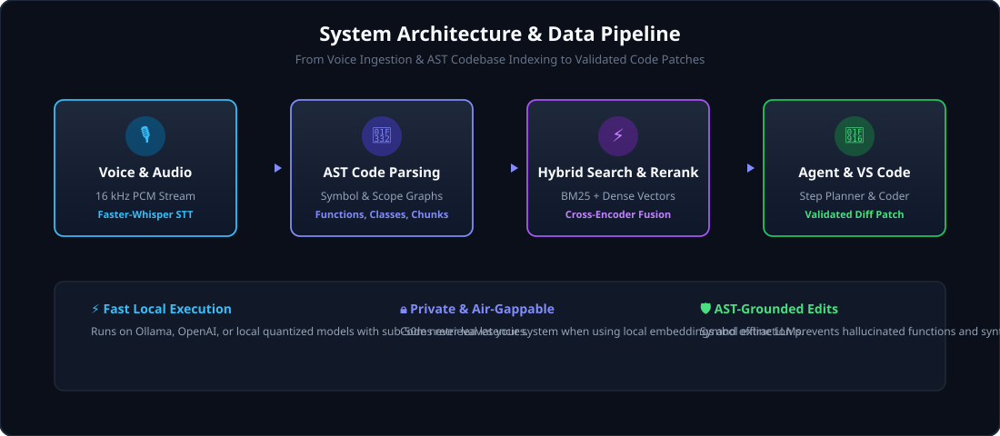

<p align="center">
  
</p>

<p align="center">
  <a href="https://github.com/Nitro-Builds-Yash/Voice-Assisted-Coding-Agent/releases/latest"></a>
  
  
  <a href="./LICENSE"></a>
</p>

<p align="center">
  <strong>Speak your thoughts. Ship tested, context-aware code without breaking your flow.</strong><br>
  A low-latency, voice-driven coding assistant powered by Tree-sitter AST parsing, hybrid BM25 + dense semantic retrieval, and multi-agent code synthesis.
</p>

---

## The code intelligence that stays in your flow

<p align="center">
  
</p>

Traditional AI coding assistants rely on naive line-based chunking that tears functions in half and loses class scope. **Voice-Assisted Coding Agent** indexes your codebase at the Abstract Syntax Tree (AST) level, recognizing symbols, class hierarchies, and dependencies across Python, TypeScript, JavaScript, Java, and Markdown.

## Voice commands should understand full codebase context

Voice coding fails when the model cannot see beyond the active file. When you say *"Refactor the user authentication flow and update the login test"*, the agent coordinates a full pipeline: audio transcription via Faster-Whisper, hybrid semantic retrieval across your repository, multi-step task planning, and verified patch generation.

<table>
  <tr>
    <td width="50%">
      <strong>AST-Grounded Parsing</strong><br>
      Extracts functions, classes, and scopes cleanly using Tree-sitter and AST fallbacks so code chunks never lose structural context.
    </td>
    <td width="50%">
      <strong>Hybrid Search &amp; Reranking</strong><br>
      Combines BM25 exact keyword matching with dense Qdrant vector embeddings, fused via Cross-Encoder reranking for sub-50ms query responses.
    </td>
  </tr>
  <tr>
    <td width="50%">
      <strong>Multi-Provider Generation</strong><br>
      Natively supports local Ollama models (DeepSeek-Coder, CodeLlama), OpenAI, and OpenRouter for high-speed offline or cloud inference.
    </td>
    <td width="50%">
      <strong>Editor &amp; Diff Integration</strong><br>
      Streams structured diffs with dry-run verification, preserving formatting and catching syntax errors before applying patches.
    </td>
  </tr>
</table>

## Install &amp; Quickstart

1. **Clone the repository:**
   ```bash
   git clone https://github.com/Nitro-Builds-Yash/Voice-Assisted-Coding-Agent.git
   cd Voice-Assisted-Coding-Agent
   ```

2. **Set up a Python environment and install dependencies:**
   ```bash
   python -m venv venv
   # On Windows:
   .\venv\Scripts\activate
   # On Linux/macOS:
   source venv/bin/activate

   pip install -r requirements.txt
   ```

3. **Index your repository:**
   ```bash
   python scripts/indexing/test_index.py
   ```

4. **Launch the agent pipeline:**
   ```bash
   python scripts/testing/test_agent_pipeline.py
   ```

> [!NOTE]
> For private, completely offline execution, start [Ollama](https://ollama.com) locally (`ollama run deepseek-coder`) and configure `OLLAMA_MODEL` in your environment settings.

## Controls &amp; Capabilities

| Capability / Command | What it does |
| --- | --- |
| **Voice Dictation (`Ctrl+Alt+V`)** | Streams speech input to Faster-Whisper STT with noise suppression. |
| **AST Repository Indexing** | Scans and chunks codebases by symbol boundaries rather than arbitrary line counts. |
| **Hybrid BM25 + Vector Search** | Executes reciprocal rank fusion across lexical tokens and embedding vectors. |
| **Cross-Encoder Reranking** | Re-scores retrieved candidate snippets against the query for optimal context precision. |
| **Multi-Step Agent Planner** | Classifies requests (explanation, refactoring, bugfix, test generation) and plans execution steps. |
| **Diff Validator** | Generates standard unified diffs and verifies syntax before writing changes to disk. |

## How it works

1. **Speech Ingestion**: Captures voice input in 16 kHz mono PCM and transcribes instructions with high-accuracy local Whisper models.
2. **AST Decomposition**: Parses repository files into discrete `CodeChunk` objects tagged with symbol names, signatures, and line ranges.
3. **Dual-Index Querying**: Queries BM25 inverted indexes for identifiers and dense vector stores for semantic concept search simultaneously.
4. **Context Construction**: Formats the most relevant code chunks within the model's token budget along with conversation history.
5. **Execution &amp; Patch**: Produces structured code modifications ready to apply directly to files or review in VS Code.

## Built for Developers

- **Local-First &amp; Air-Gappable:** Run entirely locally with Ollama and sentence-transformers—no telemetry, no leaked intellectual property.
- **Persistent Index Cache:** Serializes indexes to disk for instant restart without re-parsing unaffected files.
- **Session Memory:** Retains multi-turn conversation context across queries within an interactive coding session.
- **Modular Extensibility:** Clean abstractions for LLM providers, vector backends, and AST parsers.

## Build and Test from source

To execute the test suite:

```bash
pytest tests/ -v
```

Repository layout:

```text
backend/
  agent/                Execution planning, step executor, memory manager, sessions
  codebase/             Tree-sitter AST parsers, repository scanner, chunk builder
  config/               Path resolution, settings, environment management
  core/                 Model registry, embedding manager, Qdrant store, repository manager
  generation/           Context builder, prompt synthesis, Ollama / OpenAI providers
  models/               Pydantic schemas for CodeChunk, Symbol, RetrievalResult
  monitoring/           Prometheus metrics, health checks, latency middleware
  retrieval/            BM25 indexer, semantic retriever, cross-encoder reranker
vscode-extension/       Visual Studio Code extension for voice recording & diff sync
playground/             Sample repositories for indexing and benchmarking
scripts/                Harness scripts for testing indexing, hybrid search, and pipeline
assets/                 High-resolution SVG architecture and status artwork
```

## Release

The current stable release is [v1.0.0](https://github.com/Nitro-Builds-Yash/Voice-Assisted-Coding-Agent/releases/tag/v1.0.0).

## License

Released under the [MIT License](./LICENSE).

<p align="center">
  
</p>
