<p align="center">
  
</p>

<p align="center">
  <a href="https://github.com/Nitro-Builds-Yash/voxcode/actions/workflows/ci.yml"></a>
  
  
  
  <a href="https://github.com/Nitro-Builds-Yash/voxcode/pkgs/container/voxcode"></a>
  <a href="LICENSE"></a>
</p>

<h3 align="center">Ask your repository questions out loud. Get answers with sources,<br>or a patch that's already been applied, tested and reviewed in a sandbox.</h3>

<p align="center">
  <a href="#quick-start"><b>Quick start</b></a> &nbsp;•&nbsp;
  <a href="#features"><b>Features</b></a> &nbsp;•&nbsp;
  <a href="#integrations"><b>Integrations</b></a> &nbsp;•&nbsp;
  <a href="#how-it-works"><b>How it works</b></a> &nbsp;•&nbsp;
  <a href="#crew"><b>Agent crew</b></a> &nbsp;•&nbsp;
  <a href="#review"><b>Review</b></a> &nbsp;•&nbsp;
  <a href="#learning"><b>Learning</b></a> &nbsp;•&nbsp;
  <a href="#rust-core"><b>Rust core</b></a> &nbsp;•&nbsp;
  <a href="docs/"><b>Docs</b></a> &nbsp;•&nbsp;
  <a href="CHANGELOG.md"><b>Changelog</b></a>
</p>

<br>

<p align="center">
  
</p>

<a id="features"></a>
<p align="center">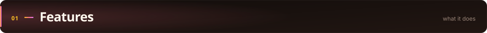</p>

<p align="center">
  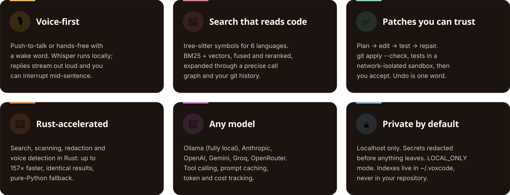
</p>

<a id="quick-start"></a>
<p align="center">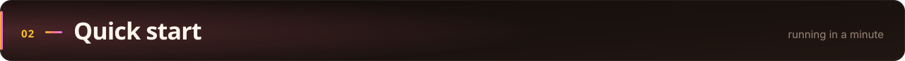</p>

```bash
git clone https://github.com/Nitro-Builds-Yash/voxcode && cd voxcode
pip install -e ".[all]"            # server, semantic search, voice, MCP
cp .env.example .env               # pick a provider (Ollama by default, so nothing leaves your machine)
voxcode serve                      # web UI → http://127.0.0.1:8000 · API docs → /docs
```

Then talk to a repository from the terminal:

```bash
voxcode index .                                              # incremental; re-run any time
voxcode ask  "how does incremental indexing work?"           # streamed answer with sources
voxcode edit "add a docstring to reciprocal_rank_fusion" --tests
```

<details>
<summary><b>⚡ Turn on the Rust core</b></summary>
<br>

```bash
pip install maturin && pip install ./native
curl -s localhost:8000/health        # → "native": {"installed": true, "active": true, ...}
```
Needs a Rust toolchain ([rustup.rs](https://rustup.rs)). Everything works without it, just slower.
</details>

<details>
<summary><b>📦 Lighter installs</b></summary>
<br>

| Command | You get |
|---|---|
| `pip install -e .` | Server, indexing, keyword search, every LLM provider. No model downloads. |
| `pip install -e ".[ml]"` | + semantic search and reranking |
| `pip install -e ".[voice]"` | + Whisper speech-to-text, microphone, Piper / pyttsx3 speech |
| `pip install -e ".[wakeword]"` | + “hey vox”-style wake word for hands-free mode |
| `pip install -r requirements/cuda.txt` | Everything, with CUDA PyTorch |
</details>

<details>
<summary><b>🐳 Docker</b></summary>
<br>

```bash
docker pull ghcr.io/nitro-builds-yash/voxcode:latest      # prebuilt image (server + Rust core)
```

```bash
WORKSPACE_DIR=~/code docker compose -f deploy/docker-compose.yml up                          # VoxCode + Redis + Qdrant
WORKSPACE_DIR=~/code docker compose -f deploy/docker-compose.yml --profile observability up  # + Jaeger, Prometheus, Grafana
```
Index projects by their container path, e.g. `/workspace/my-project`. The image includes the Rust core. The microphone and local speech need VoxCode running directly on your machine.
</details>

<a id="integrations"></a>
<p align="center"></p>

| | Where | How |
|:---:|---|---|
|  | **VS Code** | <kbd>Ctrl</kbd>+<kbd>Alt</kbd>+<kbd>V</kbd> to talk, <kbd>Ctrl</kbd>+<kbd>Alt</kbd>+<kbd>H</kbd> for hands-free, or `@vox` in Chat. The diff opens side by side; say **“accept”**. ([extension](vscode-extension/README.md)) |
|  | **Claude Desktop · Claude Code · Cursor** | `voxcode mcp --repo .` exposes search, read, references, git history, propose-edit and apply-patch as MCP tools · `voxcode hook install claude` reviews Claude Code plans in VoxCode |
|  | **Terminal** | `voxcode index · search · ask · edit · eval · swebench` |
|  | **HTTP / web UI** | REST + SSE streaming + WebSocket voice; see [docs/api.md](docs/api.md) |
|  | **GitHub** | Apply a change as a new branch or open a pull request directly |

<details>
<summary><b>MCP config snippet</b></summary>
<br>

```json
{
  "mcpServers": {
    "voxcode": { "command": "voxcode", "args": ["mcp", "--repo", "/path/to/repo"] }
  }
}
```
</details>

<a id="how-it-works"></a>
<p align="center">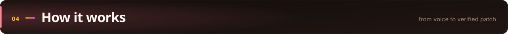</p>

<p align="center">
  
</p>

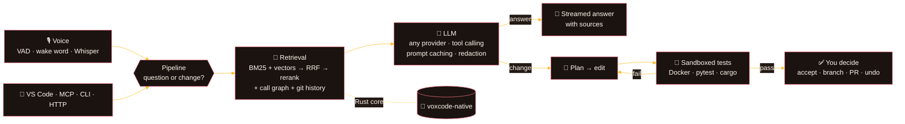

1. **Speak or type.** Short commands like “undo” are handled instantly; everything else goes to the pipeline.
2. **Retrieve.** Keyword and vector search run in parallel, are fused and reranked, and the best hits pull in their callers, callees and related commits.
3. **Generate.** Context is packed into a token budget, secrets are redacted, and the model streams its answer or uses tools to look around first.
4. **Verify.** A change is planned, written as a diff, checked, tested in a sandbox and repaired until it passes.
5. **You decide.** Accept it into your working tree, a new branch or a pull request. Undo any time.

More in [architecture.md](docs/architecture.md).

<a id="crew"></a>
## 🤝 Agent crew

One command, six specialised agents. `voxcode crew "…"` (or the `/crew` page) runs a small team on the task:

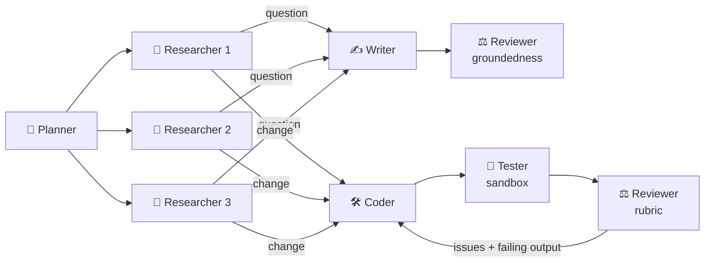

- **Parallel research.** The planner breaks the task into questions; researchers answer them at the same time with search, file and call-graph tools.
- **Checked output.** Answers are re-written if under 75% grounded in the code that was read. Patches go through the tests and a reviewer's rubric, and come back to the coder with the issues for up to two rounds.
- **Fully observable.** Every agent's tokens, tool calls and cost are metered under one budget, streamed live and saved for replay.

<p align="center">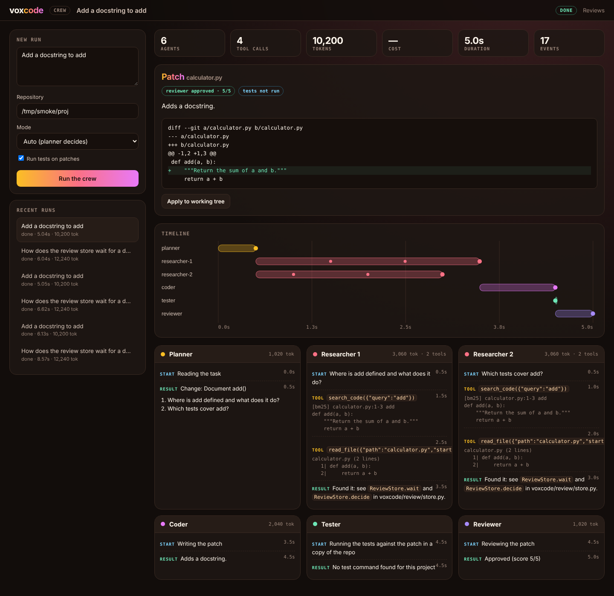</p>

```bash
voxcode crew "how does the review store wait for a decision?" --repo .
voxcode crew "add input validation to the /index route" --mode change --tests
```

<a id="review"></a>
<p align="center">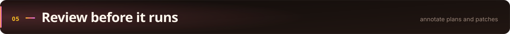</p>

Before anything touches your code, you review it in the browser: **select text in a plan to comment on it, delete it or replace it, comment on any line of a patch**, then approve or deny. A denial goes back to the agent as structured feedback, and the next version shows exactly what changed. You can also review **by voice**: hold <kbd>V</kbd> and talk, or just say *"approve"*.

<p align="center">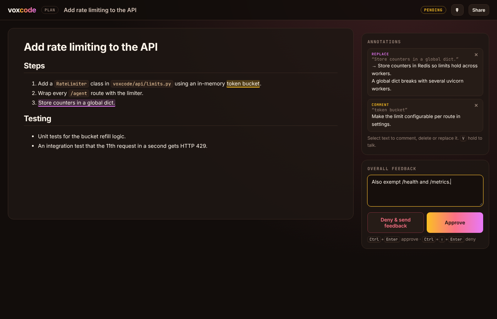</p>

It works for **Claude Code's plans too**. One command adds a plan-mode hook, and every plan Claude writes opens here instead of the terminal prompt:

```bash
voxcode hook install claude        # PermissionRequest hook on ExitPlanMode (~/.claude/settings.json)
voxcode review PLAN.md             # annotate any markdown file or .diff; the feedback is printed when you decide
```

| | |
|---|---|
| 📝 **Plan review** | Comment, delete, replace; versions v1…vN with a "what changed" diff; overall feedback |
| 🧾 **Code review** | File tree, line-numbered diff, line comments; approving applies the patch (VoxCode's own edits) |
| 🔁 **Closed loop** | Deny → the agent re-plans with your notes; approve → VoxCode writes the patch and opens it for code review |
| 🔗 **Share links** | The review is compressed into the link itself, so nothing is uploaded |
| 🗂 **Archive** | Every decision is kept at `/review`; approved plans can be saved to an **Obsidian** vault (`OBSIDIAN_VAULT`) |

<details>
<summary><b>Code review screen</b></summary>
<br>
<p align="center">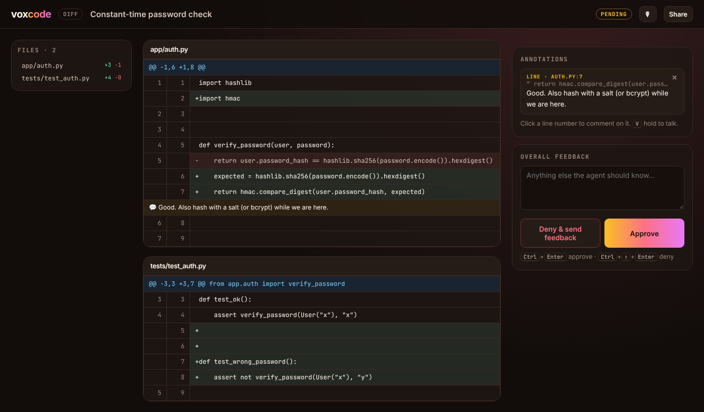</p>
</details>

The review flow was inspired by [Plannotator](https://github.com/backnotprop/plannotator). Full guide: [docs/review.md](docs/review.md).

<a id="learning"></a>
<p align="center"></p>

VoxCode is a small ML system, not just a prompt around an LLM:

| | What it does | Why it matters |
|---|---|---|
| 🧠 **Learned ranker** | A pairwise (RankNet-style) learning-to-rank model re-scores search candidates from 13 features (retriever ranks and scores, name/path overlap, test files, call-graph in-degree). It trains itself from your docstrings (inverse cloze task, docstrings hidden from the index) and from every accepted patch and 👍. | Search gets better for *your* codebase the more you use it. Saved only if it beats the plain order on held-out queries. |
| 🧩 **Contextual retrieval** | At index time an LLM writes one sentence per symbol ("validates a refund record before saving…"), indexed with the code for BM25 and embeddings. Cached by file content. | Questions use different words than code; the sentence bridges them. |
| 🪜 **Model cascade** | Easy lookups go to a small model; hard, open-ended questions go to the main one. Weak or ungrounded small-model answers are regenerated by the main model. | Lower cost and latency without accepting worse answers. |
| 🔍 **Hallucination check** | Every answer is checked for identifiers and files that don't exist in the code it was given (`quality.groundedness`). | Unsupported names are flagged in VS Code instead of silently trusted. |
| ⚡ **Answer cache** | Repeated questions return instantly until the index changes; near-duplicates match by embedding. | Zero tokens for the second ask. |
| 🎯 **Intent model** | Logistic regression on word n-grams decides answer vs. edit vs. tests, falling back to keyword rules when unsure. | "the login is broken when…" is a fix, not small talk. |

```bash
voxcode train-ranker            # train now (docstrings + feedback) and print held-out metrics and weights
voxcode eval --learning         # leave-one-out: does learning from feedback help on this repo?
```

<a id="rust-core"></a>
<p align="center">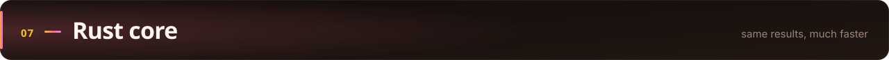</p>

<p align="center">
  
</p>

The hot paths live in [`native/`](native/) as a PyO3 extension: one abi3 wheel per platform covers Python 3.10+. Parity tests run every function through both the Rust and Python implementations and require identical output, so switching backends never changes a search result. Reproduce the numbers with `python scripts/bench_native.py`.

VoxCode also works **on** Rust projects: `impl`-aware symbols, a call graph from rust-analyzer (or a built-in resolver for `use`/`crate::`/`Self::` paths), and `cargo test` inside the repair loop.

<a id="benchmarks"></a>
<p align="center">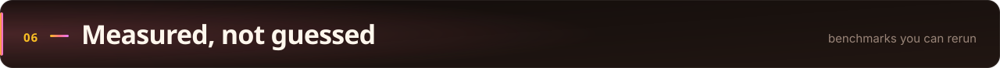</p>

| Benchmark | What it checks | Run |
|---|---|---|
| Retrieval | 30 handwritten questions about this repo: code-aware tokens lift recall@5 **0.47 → 0.67** over whitespace BM25 | `voxcode eval` |
| Local semantic model | Same 30 questions, no GPU or embedding model: hybrid BM25 + TF-IDF/SVD lifts MRR **0.49 → 0.53**, recall@5 0.63 → 0.70 over BM25 alone | `voxcode eval` |
| Learned ranker | Leave-one-out over the same questions as feedback: MRR@10 **0.50 → 0.58**, recall@5 0.67 → 0.70 | `voxcode eval --learning` |
| Intent model | 5-fold CV on 264 labelled requests: **67%** vs 57% for keyword rules; it refines the rules and never turns a question into an edit | `pytest tests/unit/test_learning.py` |
| SWE-bench Lite | Does search find the files a real GitHub fix touched? (recall@1/5/10) | `voxcode swebench` |
| Answer quality | An LLM judge grades answers against references (in CI) | `voxcode eval --answers` |
| Rust vs Python | Speed and byte-identical results | `python scripts/bench_native.py` |

<a id="layout"></a>
<p align="center"></p>

```text
voxcode/
├── voxcode/              🐍 Python package
│   ├── api/              FastAPI routes, auth, SSE/WebSocket streaming
│   ├── agent/            Q&A pipeline, planner, edit loop, tool agent, memory
│   ├── codebase/         scanner, tree-sitter parser, chunker, indexer, call graphs, git history
│   ├── retrieval/        BM25, embeddings, Qdrant, fusion, reranker, query rewriting
│   ├── generation/       context builder, prompts, streaming LLM providers
│   ├── execution/        diffs, patch apply/undo, test runner, Docker sandbox
│   ├── voice/            STT, VAD + wake word, prosody, commands, TTS
│   ├── learning/         learned ranker, relevance feedback, training
│   ├── review/           plan & patch review, Claude Code hook, archive, Obsidian export
│   ├── integrations/     MCP server, GitHub branches and PRs
│   ├── monitoring/       Prometheus metrics, OpenTelemetry tracing
│   ├── evaluation/       retrieval, SWE-bench and answer-quality benchmarks
│   └── ui/               web UI served at /
├── native/               🦀 Rust core (PyO3 + maturin)
├── vscode-extension/     🧩 VS Code extension (TypeScript)
├── tests/                ✅ unit/ and integration/ (no models or network needed)
├── deploy/               🐳 Dockerfile, docker-compose, Prometheus + Grafana
├── docs/                 📚 architecture, API, configuration, images
├── examples/             a tiny project to try VoxCode on
├── requirements/         pinned install sets (base, CUDA)
└── scripts/              launchers and the native benchmark
```

<a id="development"></a>
<p align="center">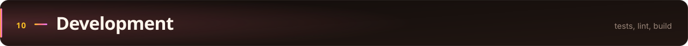</p>

```bash
pip install -e ".[dev]" && pre-commit install
pytest                                     # no models or network needed
ruff check . && ruff format --check . && mypy
cd native && cargo test && cargo clippy    # Rust core
```

CI runs all of this on Python 3.10 and 3.12, builds the Rust core and the VS Code extension, and runs the benchmarks. See [CONTRIBUTING.md](CONTRIBUTING.md) to get started.

<details>
<summary><b>🔒 Security model</b></summary>
<br>

* Runs on `127.0.0.1`; requests from other websites are rejected, so a page in your browser cannot drive VoxCode.
* Requests must be addressed to `localhost` / `127.0.0.1` / `::1` (or a name in `ALLOWED_HOSTS`), which blocks DNS-rebinding attacks.
* `API_TOKEN` requires a token; `ALLOWED_REPO_ROOTS` limits which folders can be indexed or edited.
* Secrets are redacted before code is sent to a remote model; `LOCAL_ONLY=true` refuses remote models entirely.
* Patches only touch files inside the repository, are never written without your accept, and can be undone.
* Sandboxed tests run in Docker with no network, capped memory and CPU, as a non-root user.
</details>

<p align="center">
  <br>
  <b>If VoxCode saves you a context switch, a ⭐ helps others find it.</b>
  <br><br>
  <a href="LICENSE">MIT</a> © <a href="https://github.com/Nitro-Builds-Yash">Athota Yashwanth</a>
</p>
