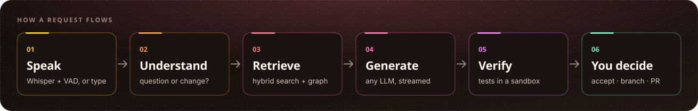

<p align="center">
  
</p>

<p align="center">
  <a href="https://github.com/Nitro-Builds-Yash/voxcode/actions/workflows/ci.yml"></a>
  
  
  
  
  <a href="LICENSE"></a>
</p>

<p align="center">
  <a href="#-quick-start"><b>Quick start</b></a> ·
  <a href="#-features"><b>Features</b></a> ·
  <a href="#-vs-code-extension"><b>VS Code</b></a> ·
  <a href="#-how-it-works"><b>How it works</b></a> ·
  <a href="docs/architecture.md"><b>Architecture</b></a> ·
  <a href="docs/api.md"><b>API</b></a> ·
  <a href="docs/configuration.md"><b>Configuration</b></a>
</p>

<br>

**VoxCode** is a voice-driven coding assistant that runs on your machine. It indexes your repository, finds the right code with hybrid search, and either **answers your question** or **writes a patch, proves it applies, runs your tests against it, and shows you the diff** before anything is written. Use it from VS Code, the built-in web UI, the CLI, or the HTTP API, with a local model through Ollama or any major cloud provider.

## ✨ Features

<table>
  <tr>
    <td width="50%" valign="top">
      <h3>🎙️ Voice in, voice out</h3>
      Push-to-talk from VS Code, local Whisper transcription, instant spoken commands (<i>“accept”</i>, <i>“undo”</i>, <i>“run the tests”</i>), and replies read aloud sentence by sentence as they stream.
    </td>
    <td width="50%" valign="top">
      <h3>🔎 Search that understands code</h3>
      tree-sitter symbols for Python, JS/TS, Java, Go and Rust. Code-aware BM25 and dense vectors, fused with RRF, reranked, then expanded with callers and callees from a call graph.
    </td>
  </tr>
  <tr>
    <td valign="top">
      <h3>✅ Patches you can trust</h3>
      Every change is a unified diff checked with <code>git apply --check</code>, optionally tested in a throwaway copy, reviewed by a second model pass, and retried with the errors. You accept, reject or undo.
    </td>
    <td valign="top">
      <h3>⚡ Fast and incremental</h3>
      Only changed files are re-parsed and re-embedded, embeddings are cached on disk, a file watcher keeps the index fresh, and answers stream token by token.
    </td>
  </tr>
  <tr>
    <td valign="top">
      <h3>🔌 Any model</h3>
      Ollama (fully local), Anthropic, OpenAI, Gemini, Groq and OpenRouter, all streamed and switchable at runtime. An agentic mode lets the model search and read files before answering.
    </td>
    <td valign="top">
      <h3>🔒 Local and safe by default</h3>
      Binds to localhost, blocks requests from other websites, and supports an API token and a folder allow-list. Indexes live in <code>~/.voxcode</code>, never inside your repositories.
    </td>
  </tr>
</table>


## What's new in v0.5

- **MCP server** — use VoxCode's index from Claude Desktop, Claude Code or Cursor: `voxcode mcp --repo .`
  ```json
  {"mcpServers": {"voxcode": {"command": "voxcode", "args": ["mcp", "--repo", "/path/to/repo"]}}}
  ```
- **`@vox` in VS Code Chat**, plan review before edits, apply to a **branch or pull request**.
- **Hands-free voice** — VAD segmentation, optional wake word, barge-in, tone from prosody.
- **Smarter retrieval** — Jedi call graph, git-history search, optional query rewriting.
- **Agent** — native tool calling, plan → edit → test → repair, Docker-sandboxed tests.
- **Privacy & cost** — secret redaction, `LOCAL_ONLY` mode, prompt caching, token/cost tracking.
- **Observability** — per-stage timings, OpenTelemetry traces, Grafana dashboard: `docker compose --profile observability up`.
- **Evaluation** — `voxcode swebench` (SWE-bench localization), `voxcode eval --answers` (LLM judge), `--embedding-models` comparison.

## 🚀 Quick start

```bash
git clone https://github.com/Nitro-Builds-Yash/voxcode && cd voxcode
pip install -r requirements.txt     # everything: server, semantic search, voice
cp .env.example .env                # choose a provider; add an API key if it needs one
voxcode serve                       # web UI on http://127.0.0.1:8000 · API docs on /docs
```

Ollama is the default provider (`ollama pull qwen3:8b`), so nothing leaves your machine unless you choose a cloud model.

**Try it from the terminal:**

```bash
voxcode index .                                          # incremental; re-run any time
voxcode search "where are patches validated"
voxcode ask    "how does incremental indexing work?"     # streamed answer
voxcode edit   "add a docstring to reciprocal_rank_fusion" --tests   # validated diff, nothing written
```

<details>
<summary><b>Lighter installs</b></summary>

<br>

| Command | You get |
|---|---|
| `pip install -e .` | Server, indexing, keyword search, all LLM providers. Fast; no models to download. |
| `pip install -e ".[ml]"` | + semantic search and reranking (models download on first use) |
| `pip install -e ".[voice]"` | + Whisper speech-to-text, microphone capture, Piper / pyttsx3 speech |
| `pip install -r requirements-cuda.txt` | Everything, with CUDA PyTorch |

Without the `ml` extra everything still works, using keyword search only. Redis and a Qdrant server are optional too: by default memory is in-process and vectors are stored under `~/.voxcode`.
</details>

<details>
<summary><b>Docker</b></summary>

<br>

```bash
WORKSPACE_DIR=~/code docker compose up    # VoxCode + Redis + Qdrant, CPU PyTorch
```

Index projects by their container path, e.g. `/workspace/my-project`. Microphone capture and local speech playback need VoxCode running directly on your machine rather than in Docker.
</details>

## 🧩 VS Code extension

```bash
cd vscode-extension && npm install && npm run compile
npx @vscode/vsce package && code --install-extension voxcode-*.vsix
```

| Do | How |
|---|---|
| Talk | <kbd>Ctrl</kbd>+<kbd>Alt</kbd>+<kbd>V</kbd> to start, again to stop (or click **Vox** in the status bar) |
| Type instead | <kbd>Ctrl</kbd>+<kbd>Alt</kbd>+<kbd>T</kbd> |
| Ask a question | The answer streams into the **VoxCode** output panel, optionally read aloud |
| Ask for a change | A side-by-side diff opens. Say **“accept”**, **“reject”** or **“next file”** |
| Change your mind | Say **“undo”** |
| Check your work | Say **“run the tests”** |

The workspace is indexed when VS Code starts and re-indexed as you edit. Settings live under `voiceCoding.*` ([details](vscode-extension/README.md)).

## 🧠 How it works

<p align="center">
  
</p>

1. **Speak.** Whisper (with voice-activity detection) transcribes your request; short commands like “undo” are handled instantly without the model.
2. **Understand.** The request is classified as a question or a code change.
3. **Retrieve.** BM25 and vector search run in parallel, are fused and reranked, and the best hits pull in their callers and callees.
4. **Generate.** The context is packed into a token budget and the model streams its reply.
5. **Verify.** For changes: `git apply --check`, tests in a sandbox copy, and a review pass, with retries on failure.
6. **You decide.** Review the diff, accept or reject it, and undo with one word.

The [architecture notes](docs/architecture.md) cover indexing, editing and agentic mode in detail.

## 📊 Retrieval quality

`voxcode eval` asks 30 natural-language questions about this repository and checks whether the right function comes back:

| Search | recall@5 | MRR@10 |
|---|:---:|:---:|
| BM25, whitespace tokens (previous version) | 0.50 | 0.42 |
| **BM25, code-aware tokens** | **0.80** | **0.54** |

With the `ml` extra installed it also reports semantic, hybrid and hybrid + rerank. The questions were written by the developers, so treat this as a regression check rather than a general benchmark.

## 🗂️ Project layout

```text
voxcode/
├── voxcode/               Python package
│   ├── api/               FastAPI routes and security middleware
│   ├── agent/             planner, Q&A pipeline, edit loop, tool agent, memory
│   ├── codebase/          scanner, tree-sitter parser, chunker, indexer, call graph, watcher
│   ├── retrieval/         BM25, embeddings, Qdrant, fusion, reranker
│   ├── generation/        context builder, prompts, streaming LLM providers
│   ├── execution/         diff parsing, patch apply/undo, sandboxed test runner
│   ├── voice/             speech-to-text, recorder, voice commands, text-to-speech
│   ├── evaluation/        retrieval benchmark
│   ├── ui/                web UI served at /
│   └── cli.py             the `voxcode` command
├── vscode-extension/      VS Code extension (TypeScript)
├── tests/                 unit/ and integration/ (no models or network needed)
├── docs/                  architecture, API, configuration, images
├── examples/sample_repo/  tiny project to try VoxCode on
└── scripts/               run.sh / run.ps1 launchers
```

## 🔒 Security

* Runs on `127.0.0.1`; requests from other websites are rejected, so a page in your browser cannot reconfigure VoxCode or read your code.
* Set `API_TOKEN` to require a token and `ALLOWED_REPO_ROOTS` to limit which folders can be indexed or edited.
* Patches can only touch files inside the repository, are never applied without an explicit accept (unless you enable auto-apply), and the last one can always be undone.
* Testing a patch runs your project's own test suite in a temporary copy; “run the tests” runs it in place.

## 🛠️ Development

```bash
pip install -e ".[dev]" && pre-commit install
pytest                                   # unit + integration tests, no models or network needed
ruff check . && ruff format --check . && mypy
```

CI runs these on Python 3.10 and 3.12, plus the retrieval benchmark and the extension build. See [CONTRIBUTING.md](CONTRIBUTING.md).

<details>
<summary><b>A note on tone adaptation</b></summary>

<br>

With `EMOTION_ENABLED=true`, a keyword heuristic guesses whether you sound rushed, frustrated, tired or curious and adjusts the reply style (for example, the fix first and less explanation). It only shapes the system prompt and never changes what is searched. It reads the transcript, not your voice, so treat it as a hint.
</details>

## 📄 License

[MIT](LICENSE) © Yash ([Nitro-Builds-Yash](https://github.com/Nitro-Builds-Yash))
